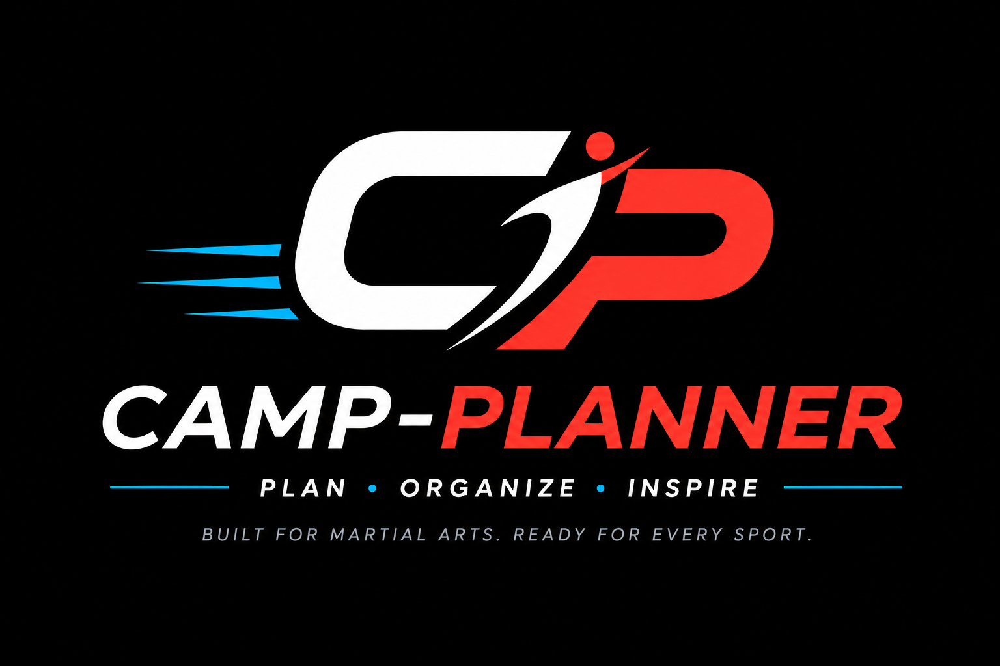

# Camp-Planner approved dark logo

Approved by Martin on 29 October 2026.

- File: `assets/logos/camp-planner-logo-black-2026-10.png`
- Format: PNG, 1536 × 1024 pixels.
- Background: opaque black. This is not a transparent image or SVG.
- SHA-256: `e7bdd084eb93e7bcc2aed7b4a3f89f5b196fae6831feee668d2b3d17dd7e9e82`
- Keep the original aspect ratio and colors; do not stretch, recolor, add glow, or remove the background by a white-pixel threshold.
- Use on black surfaces or an intentional black brand tile. Keep existing light versions and transparent watermarks for their respective uses.

The existing logo-dark.png and logo-dark-black.png aliases contain this same approved artwork, so existing header and footer references are updated.
